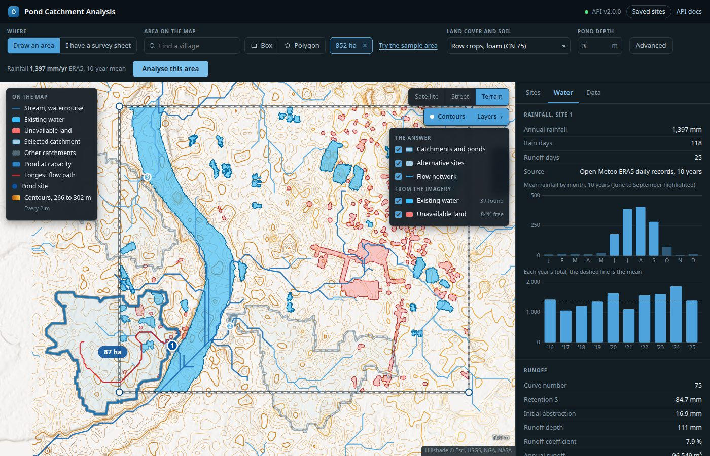
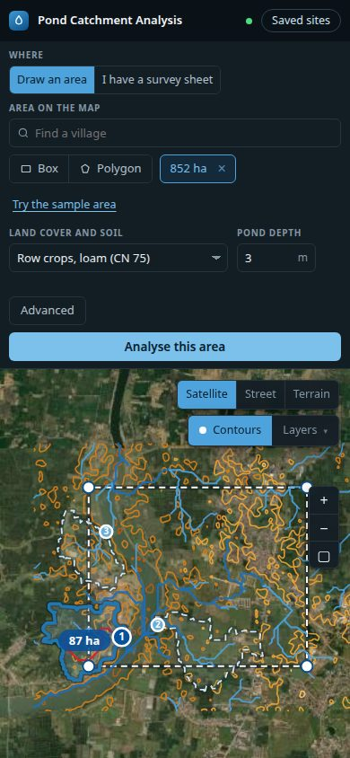
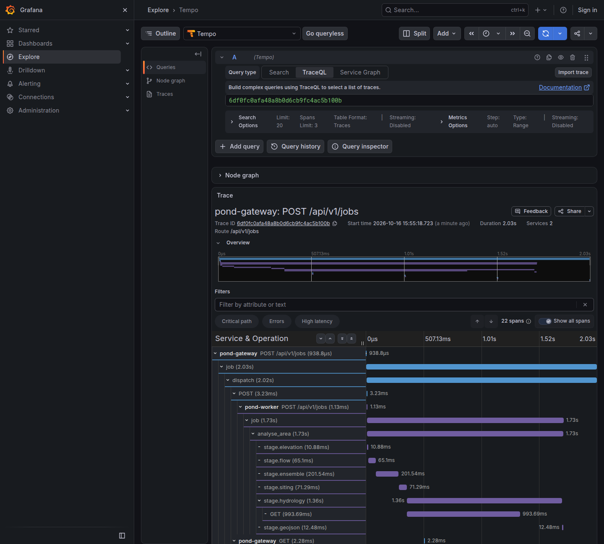
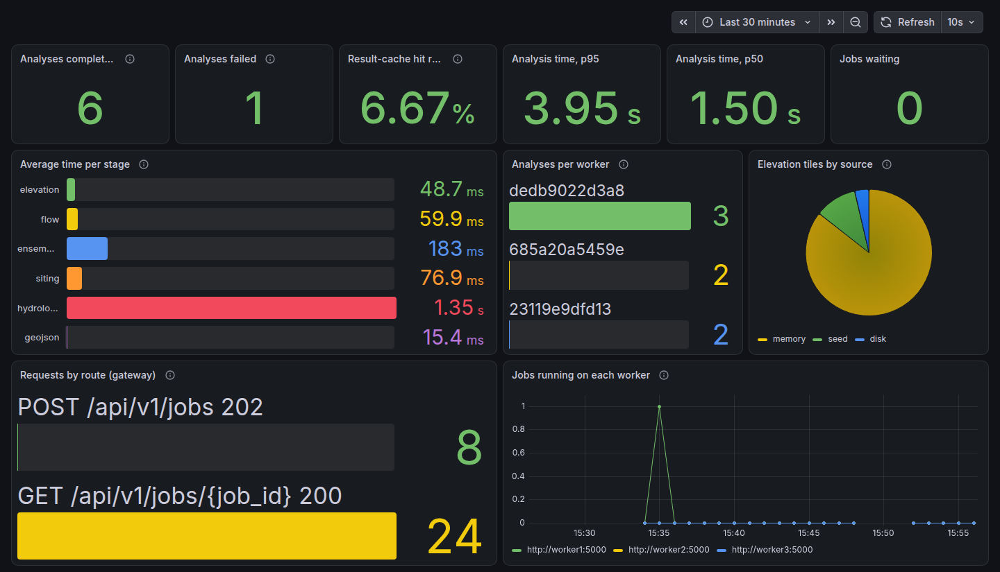

# Pond Catchment Analysis

Draw a box on a map. Get back where to dig a village pond, the ground that drains into
it, and how much water it'll hold in an average year — all overlaid on the map.

**[Try the live demo →](https://pond-catchment-analysis-vt7g.onrender.com)**


## What it does

- **Pick the land** — search a village, then drag a box or draw a polygon around it.
- **Free elevation** — SRTM terrain tiles fill in the heights, no upload needed. Have a
  surveyed contour sheet instead? Upload the KML/KMZ for the same answer at survey accuracy.
- **Finds the pond site** — routes water downhill across the terrain, ranks locations by
  how much drains into them, and keeps a safe distance from watercourses.
- **Estimates the water** — ten years of real rainfall for that spot, run through the
  SCS curve-number runoff model, turned into a fill curve for the pond.
- **Shows the work** — catchment boundary, flow paths, contours, and (from satellite
  imagery) existing ponds and buildable land, all on the map. Export as GeoJSON or PNG,
  save an analysis, reopen it later.

A sample area near Raipur, Chhattisgarh is one click away and resolves in about half a second.

| Rainfall and runoff | Imagery layers | On a phone |
|---|---|---|
|  |  |  |

## Tech stack

- **Backend:** Python 3.12, FastAPI, NumPy, SciPy, Pydantic
- **Front end:** one HTML file, no build step
- **Infrastructure:** Docker Compose, nginx, SQLite, deployed on Render
- **Observability:** OpenTelemetry traces, metrics and logs into Grafana, Tempo and Loki
- **Data:** SRTM terrain tiles, Open-Meteo ERA5 rainfall, Esri satellite imagery

## Running it locally

```bash
docker compose up -d --build
# open http://localhost:5229 and press "Try the sample area"
```

or hit the API directly:

```bash
curl -X POST http://localhost:5229/api/v1/analyzeArea -H 'Content-Type: application/json' \
     -d '{"bbox": [81.2814, 21.2398, 81.3126, 21.2636]}'
```

A single-process dev server (no Docker) and the multi-host setup are in
[docs/INSTALL.md](docs/INSTALL.md).

## How it works

```
browser ── frontend (nginx) ── gateway ─┬─ worker ─┐
                                        ├─ worker ─┼── cv (imagery)
                                        └─ worker ─┘
          saved sites: SQLite on the gateway's volume
```

One codebase, one Docker image. Whether a process is a gateway, a worker, or the
imagery service is decided entirely by its environment variables. Run it with nothing
set and it analyzes requests itself, which is what the live demo does. The gateway
queues jobs, caches results and sends each job to the least-busy worker. Every service
runs under a 512 MB memory cap ([load-test results](docs/SCALING.md)).

The analysis pipeline: elevation → DEM → pit filling → D8 flow direction and
accumulation → stream network → ranked pond sites → catchment delineation → rainfall
and SCS runoff → stage-storage curve. [docs/METHODOLOGY.md](docs/METHODOLOGY.md) walks
through each step.

| Path | What lives there |
|---|---|
| `app/core/` | The analysis: DEM building, hydrology, catchment delineation, pond siting, contouring |
| `app/providers/` | Elevation tiles and rainfall, each behind a cached interface |
| `app/cv/` | Satellite imagery: existing water bodies and buildable land |
| `app/pipeline.py` | Ties it together: a contour sheet or a map area, same answer out |
| `app/jobs.py` | Async jobs with per-stage progress, a result cache, and dispatch across workers |
| `static/index.html` | The whole front end |
| `tests/` | The test suite, with synthetic terrain where the right answer is known |
| `tools/` | Load testing, the scaling matrix, survey validation, tile prewarming |
| `deploy/` | nginx config, the Grafana dashboard, and multi-host deploy scripts |
| `docs/` | API reference, methodology, validation and scaling results |

Full endpoint reference: [docs/API.md](docs/API.md), or `/docs` on any running instance.

## How accurate is it?

The free SRTM elevation was checked against a real 1 m contour survey of the same
ground ([docs/VALIDATION.md](docs/VALIDATION.md)): the two DEMs agree to 0.26 m RMSE,
and both recommend a pond in the same valley, 400 m apart. That is close enough to find
the site, but it should still be surveyed before construction.

## Observability

`docker compose up` also starts a Grafana stack that collects OpenTelemetry traces,
metrics and logs from the gateway, the workers and the CV service. Run
`tools/generate_load.sh`, then open <http://localhost:3000> (admin / admin).
**Explore > Tempo** shows one trace per job, from the gateway through the worker's
pipeline stages to the elevation and rainfall calls it makes. Telemetry is off unless
`OTEL_EXPORTER_OTLP_ENDPOINT` is set, so the tests and the Render deploy don't send any.

| One job traced across services | Metrics dashboard |
|---|---|
|  |  |

## Tests

```bash
pip install -r requirements.txt
pytest
```

590 tests, no network required. Elevation and rainfall are stubbed with known
answers, so a run reproduces the same result every time.

## Documentation

- [docs/METHODOLOGY.md](docs/METHODOLOGY.md): the hydrology and siting method, and how it was validated
- [docs/VALIDATION.md](docs/VALIDATION.md): free SRTM elevation compared with a 1 m survey
- [docs/SCALING.md](docs/SCALING.md): throughput and memory under load
- [docs/API.md](docs/API.md): every endpoint, field and error code
- [docs/INSTALL.md](docs/INSTALL.md): running it as one process, with Docker Compose, or across four hosts
