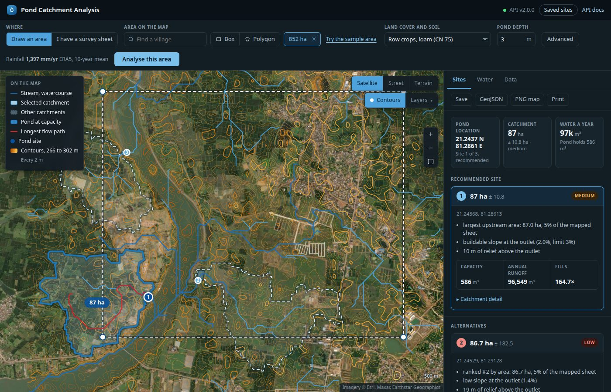
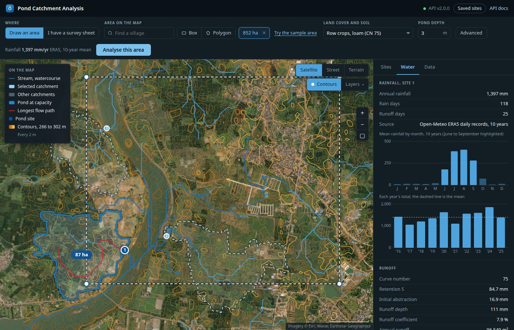

# Pond Catchment Analysis

Draw a box on a map. Get back where to dig a village pond, the land that drains into it,
and how much water it will hold in an average year.

**[Live demo →](https://pond-catchment-analysis-vt7g.onrender.com)**



## What it does

- **Pick any land.** Search for a village, then draw a box or a polygon around it.
- **No upload needed.** Free SRTM elevation tiles supply the heights. You can also upload a
  surveyed contour sheet (KML or KMZ) for a more exact answer.
- **Finds the pond site.** It routes water downhill, ranks the spots by how much drains
  into them, and keeps them clear of streams.
- **Estimates the water.** It uses ten years of real rainfall and the SCS runoff model to
  build a fill curve for the pond.
- **Shows its work.** Catchments, flow paths, contours, existing ponds and buildable land
  all appear on the map. You can export GeoJSON or a PNG, and save an analysis for later.

| Rainfall and runoff | Satellite layers |
|---|---|
|  |  |

## Try it

```bash
docker compose up -d --build
```

Open <http://localhost:8080> and press **Try the sample area**. Or call the API directly:

```bash
curl -X POST http://localhost:8080/api/v1/analyzeArea \
     -H 'Content-Type: application/json' \
     -d '{"bbox": [81.2814, 21.2398, 81.3126, 21.2636]}'
```

For a single process without Docker, run `pip install -r requirements.txt` and then
`uvicorn app.main:app`. Interactive API docs are at `/docs`.

## How it works

The pipeline has seven steps:

> elevation → DEM → fill pits → D8 flow routing → pond sites → catchments → runoff and storage

The same Docker image can run as a gateway, a worker or an imagery service. Environment
variables pick the role. With none set, one process does everything, which is how the live
demo runs. The compose stack adds a gateway, three workers and a satellite-imagery service.
Each is capped at 512 MB.

## How accurate is it?

I checked the free SRTM terrain against a real 1 m contour survey of the same ground. The
two surfaces agree to 0.26 m RMSE. Both recommend a pond in the same valley, 400 m apart.
That is good enough to find a site. Survey it before you build.

## Built with

Python 3.12, FastAPI, NumPy, SciPy and Pydantic on the backend. The front end is one HTML
file with no build step. Docker Compose, nginx and SQLite run the stack, and it is deployed
on Render. Data comes from SRTM terrain tiles, Open-Meteo rainfall and Esri imagery.

## Observability

The compose stack sends OpenTelemetry traces, metrics and logs to Grafana. Run
`tools/generate_load.sh`, then open <http://localhost:3000> (login `admin` / `admin`).
Each job shows up as one trace, from the gateway to the worker and the elevation and
rainfall calls it makes.

| One job, traced across services | Metrics dashboard |
|---|---|
|  |  |

## Project layout

| Path | Contents |
|---|---|
| `app/core/` | DEM building, hydrology, catchments, pond siting, contours |
| `app/providers/` | Elevation and rainfall sources, each cached |
| `app/cv/` | Existing water and buildable land from satellite imagery |
| `app/jobs.py` | Async jobs with progress, a result cache and worker dispatch |
| `static/index.html` | The whole front end |
| `tests/` | Tests on synthetic terrain with known answers |
| `tools/` | Smoke test, load test, validation and tile prewarming |
| `deploy/` | nginx config and the Grafana dashboard |

## Tests

```bash
pytest
```

There are 591 tests. They need no network, because elevation and rainfall are stubbed
with known answers. A full run takes about three minutes.
