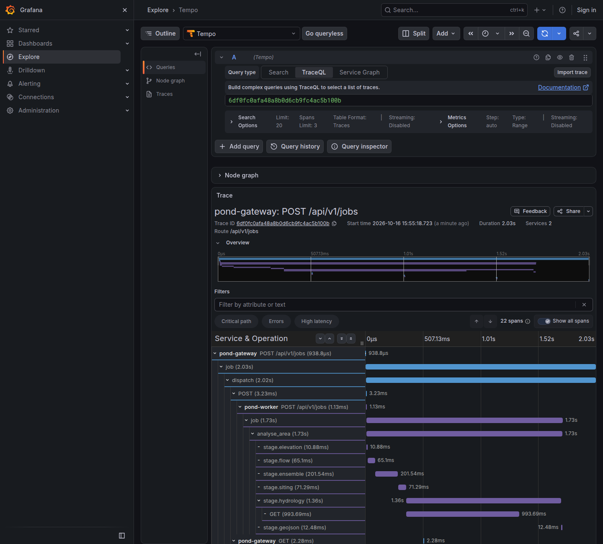
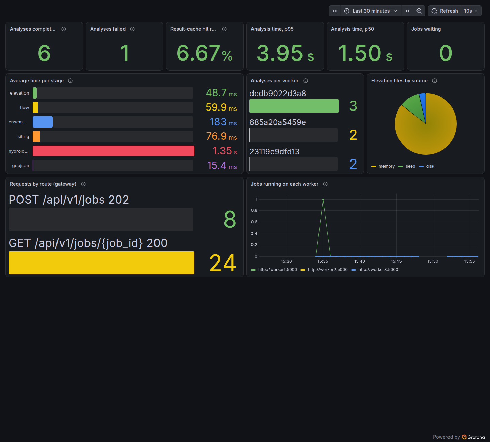

# Village Pond Planning System — Observability report

**Traces, metrics and logs across the gateway, the workers and the CV service, using
OpenTelemetry, viewed in Grafana.** The stack was already split over six containers by
Phase 3. A slow or failed analysis could be anywhere in that path, and the only evidence
was a per-stage timing table inside the response of the job that had already finished.
This work makes the same questions answerable for every request, live, across services.



*One `POST /jobs` for the sample area, as Tempo shows it: the gateway's `job` and
`dispatch` spans, the HTTP call to the worker, the worker's `analyse_area`, one span per
pipeline stage, and, under `stage.hydrology`, the 994 ms Open-Meteo request that makes
that stage the longest. 22 spans, 2.03 s, two services, one trace id.*

---

## 1. What was asked, and where it is

| Question | Answer | Where |
|---|---|---|
| Where did the time go for this request? | A span per pipeline stage, nested under the request | `app/pipeline.py` (`Stopwatch`) |
| Which worker ran it, and did it fail? | `pond.job.id`, `pond.job.worker`, `pond.job.status`, `pond.error.code` on the job span | `app/jobs.py`, `app/routers/analyze.py` |
| Is the external dependency slow or down? | urllib and httpx calls are child spans; a rainfall fallback is logged | `app/telemetry.py`, `app/providers/rainfall.py` |
| Is the system healthy right now? | Dashboard: outcomes, latency percentiles, queue depth, per-worker load | `deploy/grafana/pond-dashboard.json` |
| Can a log line be tied to its request? | Logs go out with the active trace id | `app/telemetry.py` |
| Does it cost anything when unused? | Off unless `OTEL_EXPORTER_OTLP_ENDPOINT` is set | §2 |

## 2. Design

**One module, API calls everywhere else.** `app/telemetry.py` creates a tracer, a meter
and the instruments at import time and exposes `setup()`. The pipeline, the dispatcher and
the providers only call the OpenTelemetry *API*, which does nothing until an SDK is
installed. `setup()` returns immediately when `OTEL_EXPORTER_OTLP_ENDPOINT` is unset, so
`pytest`, a bare `uvicorn` run and the Render deploy behave exactly as before. In
docker-compose the variable points at the `otel` service. To switch it off there, remove
that line from `docker-compose.yml`; setting it to an empty value does not work, because
the compose default (`:-`) treats empty as unset and restores the endpoint.

**Backend.** One extra compose service, `grafana/otel-lgtm`: an OTLP receiver with Tempo
(traces), Prometheus (metrics), Loki (logs) and Grafana on port 3000. The services export
over OTLP/HTTP directly to it; there is no separate collector to configure. Data lives in
the `otel-data` volume.

**Service names.** The gateway reports as `pond-gateway`, a worker as `pond-worker` (the
same test `/health` uses for the role: workers configured means gateway) and the CV
container as `pond-cv`. `service.instance.id` is the container hostname, which is what
tells the three workers apart.

### 2.1 What is recorded

**Traces**

| Span | Source | Notes |
|---|---|---|
| `POST /api/v1/jobs`, `GET /api/v1/jobs/{id}` | FastAPI auto-instrumentation | `/health` is excluded, the container healthcheck hits it every 15 s |
| `job` (gateway), `dispatch` | `JobRunner._run`, `_run_remote` | Attributes: job id, local or gateway dispatch, worker URL, final status |
| `POST` (gateway to worker) | httpx auto-instrumentation | Carries `traceparent`, so the worker's spans join the gateway's trace |
| `job` (worker), `analyse_area` | worker | Attributes: AOI kind, DEM cell count, site count, error code |
| `stage.elevation`, `.flow`, `.ensemble`, `.siting`, `.hydrology`, `.geojson` | `Stopwatch.stage` | Recorded even when the stage raises |
| `GET` (Open-Meteo, elevation tiles) | urllib auto-instrumentation | Child of the stage that made the call |
| `imagery.tiles` | `app/cv/imagery.py` | Satellite tile fetch |

**Metrics** (all exported every 5 s)

| Name | Type | Labels |
|---|---|---|
| `pond.analyses` | counter | `outcome` = ok / error |
| `pond.analysis.duration` | histogram, s | `outcome` |
| `pond.stage.duration` | histogram, s | `stage` |
| `pond.job.cache` | counter | `result` = hit / miss |
| `pond.tiles` | counter | `source` = seed / memory / disk / network / missing |
| `pond.jobs.queued` | gauge | none |
| `pond.worker.in_flight` | gauge | `worker` |
| `http.server.*`, `http.client.*` | auto | route, method, status |

Histograms use explicit second-scale buckets (0.05 s to 60 s) because the SDK default
buckets are millisecond-scale and would put every analysis in one bucket.

**Logs.** The standard `logging` module is bridged to OTLP at INFO level for the root
logger and uvicorn. The code logs under `pond.analysis`, `pond.jobs`, `pond.elevation` and
`pond.rainfall`: job queued, dispatched, done, failed; a rejected submission when the
queue is full; a worker that dropped; elevation tile origins; and the rainfall fallback.

## 3. Problems found while building it

- **Pool threads dropped the trace.** Elevation and satellite tiles are fetched in a
  `ThreadPoolExecutor`. A new thread does not inherit the request's OpenTelemetry context,
  so each tile fetch would have started a separate trace. Each tile now runs inside
  `contextvars.copy_context().run(...)`, which keeps it under the request's trace
  (`app/providers/elevation.py`, `app/cv/imagery.py`).
- **The background task outlives the request.** The job is run by an `asyncio` task
  created inside `POST /jobs`. The task copies the context at creation, so the `job` span
  joins the submitting request's trace even though the HTTP response has long since
  returned. This is why the trace above is rooted at the 0.9 ms POST and its `job` child
  lasts 2.03 s.
- **Noise.** FastAPI instrumentation emits a span for every ASGI `send` and `receive`;
  these were turned off (`exclude_spans`), which took the same trace from 40 spans to 22.
  The gateway polls the worker once per 500 ms; those `GET /jobs/{id}` calls remain
  visible and show the polling cost honestly.
- **Cold-start export.** Metrics are cumulative per process. After a container restart the
  counters begin again at zero, which is how a dashboard taken straight after a restart
  showed "No data" until load was run again.

## 4. Verification

| Check | Result |
|---|---|
| Test suite with the new code | 590 passed (3 min), telemetry off |
| Stack start | 7 containers up and healthy, `otel` included |
| `tools/generate_load.sh` | 8 jobs: 6 done on 3 workers, 1 served from the result cache, 1 failed (`no_site_found`, open ocean) |
| Tempo | gateway and worker spans share one trace id; the worker's span parent is the gateway's HTTP client span |
| Prometheus | 11 `pond_*` series plus the HTTP series present |
| Loki | `service_name` values `pond-gateway`, `pond-worker`, `pond-cv` present |
| Browser | the app, run with telemetry on, analyses the sample area and renders as before (`figures/otel/01_app.png`) |



*After one run of the load script: 6 analyses completed, 1 failed, p50 1.5 s and p95
3.95 s. Hydrology averages 1.35 s per analysis and is the longest stage; the other five
together take under 0.4 s. Work was spread across the three workers (3, 2 and 2).*

## 5. What the data says

- **Hydrology dominates the pipeline.** Averaged over the six analyses it takes 1.35 s,
  and in the trace almost all of that is the single Open-Meteo request (994 ms). Elevation
  (49 ms on average) and flow (60 ms) are small, because the tiles come from the committed
  seed or a cache. The profile of an analysis is the latency of a weather API, not
  compute. A cache shared between workers, or a longer rainfall cache lifetime, would help
  more than any change to the terrain code.
- **The dispatcher is balanced.** With the `least_busy` policy the three workers took 3, 2
  and 2 analyses.
- **A failed job is cheap and visible.** The open-ocean request failed in about 1 s with
  `pond.error.code = no_site_found` on its span, and it is counted under
  `outcome="error"`.
- **Cache hits cost nothing.** A repeated area is answered by the gateway without any
  worker span at all.

## 6. Limits, stated plainly

- **Overhead was not measured.** The analyses took about 2 s each with telemetry on, the
  same order as before, but I did not run the scaling benchmark (`tools/scaling.py`) with
  and without it, so there is no number for the cost. The batch exporters run in a
  background thread; the memory they add to a 512 MB worker has not been measured.
- **Not deployed to the lab.** The `otel` image is about 2.7 GB and is not inside the
  512 MB envelope the workers are held to. Only the local compose stack was run. On the
  lab or on Render the endpoint variable is unset, so nothing is sent.
- **Logs were checked by label, not by content.** Loki holds the three service names, but
  a log line with its trace id was not inspected in the Grafana UI.
- **The CV service's traces were not inspected.** Its spans use the same code, and it
  appears in Loki, but none of the checks above opened a trace that includes it.
- **No alerts and no retention policy.** The dashboard is for looking at; nothing pages
  anyone. Data is kept in a Docker volume with the backend's defaults.
- **Credentials are Grafana's defaults** (admin / admin), acceptable for a local demo only.

## 7. Using it

```bash
docker compose up -d --build
tools/generate_load.sh                      # a varied workload; optional base URL argument
# Grafana: http://localhost:3000  (admin / admin)
#   Explore > Tempo      one trace per job
#   Explore > Loki       {service_name="pond-worker"}
#   Dashboards           import deploy/grafana/pond-dashboard.json, or:
curl -u admin:admin -H 'Content-Type: application/json' \
     -d @deploy/grafana/pond-dashboard.json http://localhost:3000/api/dashboards/db
```

`python deploy/grafana/build_dashboard.py` regenerates the dashboard JSON. To run with
telemetry off, remove the `OTEL_EXPORTER_OTLP_ENDPOINT` line from `docker-compose.yml`.

Dependencies are pinned in `requirements.txt`: the OpenTelemetry API, SDK and OTLP/HTTP
exporter at 1.30.0, and the FastAPI, httpx and urllib instrumentation at 0.51b0.
